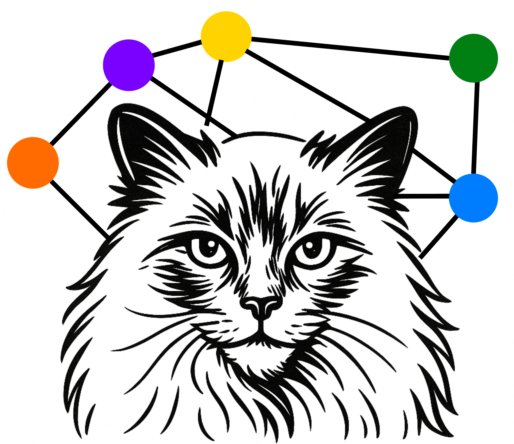

<p align="center">
  
</p>

<h1 align="center">FEYDOnto</h1>

<h3 align="center">An Aesthetic Ontology Visualizer</h3>

<p align="center">
  An ontology viewer built for <b>figures you can put in papers and demos</b>.<br>
  FEYDOnto, for <b>F</b>igures <b>E</b>xactly as <b>Y</b>ou <b>D</b>esign them, from <b>O</b>ntologies. Also the name of a very good cat.
</p>

- **Choose exactly what to draw** – tick individual classes, properties and *individuals*
  (e.g. three individuals out of ten thousand). By default, clicking a class checkbox (un)ticks the class and all its
  subclasses, and Shift+click (un)ticks only that class; turning the option off swaps the two. The ⊟ button at the end of a class row (or *Hide its subclasses* in the
  canvas right-click menu) hides all its subclasses while keeping the class.
- **Protégé colours** – classes amber, object properties blue, datatype properties green, individuals purple,
  annotations grey, in the diagram, the lists and the inspector.
- **Annotations** – `rdfs:comment`, `skos:definition`, `dcterms:*` and any `owl:AnnotationProperty`: shown as a
  marker on annotated nodes (hover to read), as text inside the box, or as a UML note. You can filter them by
  language and choose which annotation properties to show.
- **Arrow labels** – optional text on subclass and instance-of arrows (`subClassOf`, `is-a`, `rdf:type`, …).
- **Explore from the canvas** – double-click a node to reveal its neighbours; right-click for
  *show subclasses / superclasses / individuals / connected*, *isolate*, *hide*.
- **Publication-quality output** – hierarchical (ELK) layout where layers = taxonomy depth, UML-style
  hollow subclass arrows, datatype properties as attribute rows inside class boxes, `some / only / min / max`
  restrictions as labelled edges, print-friendly and black & white themes, serif fonts, legend.
- **Export** clean, editable **SVG** (real text, no external CSS) or **PNG** up to 4×, or copy the PNG to the clipboard.
- **Reproducible figures** – *Save view* stores selection, layout, positions and style as JSON; *Load view* restores it.
- Undo / redo (Ctrl/⌘+Z), quick search (`/`), drag & drop files, `?url=https://…/onto.ttl` deep links.

Reads **RDF/XML** (`.rdf`, `.owl`), **Turtle**, **N-Triples**. (Protégé's OWL/XML and Functional syntax: re-save as RDF/XML or Turtle.)

## Prerequisites

FEYDOnto is a static web page: there is nothing to install or build (no npm, no bundler).

- **A recent web browser**: Chrome, Edge, Firefox or Safari, 2022 or newer.
- **An internet connection**: the libraries ([d3](https://d3js.org), [elkjs](https://github.com/kieler/elkjs),
  [N3.js](https://github.com/rdfjs/N3.js)) are loaded from CDNs. Offline, the diagram cannot be drawn.
- **A local web server, only to run it on your own machine**: browsers block ES modules and file loading on
  `file://` pages, so opening `index.html` directly does not work. Python 3 (preinstalled on macOS and most
  Linux distributions) is enough; `npx serve` or VS Code's *Live Server* extension work too.

## Run

```sh
git clone https://github.com/B-Gendron/feydonto.git
cd feydonto
python3 -m http.server 8000     # then open http://localhost:8000
```

To publish it, enable GitHub Pages on the repository (*Settings › Pages*, branch `main`, folder `/`):
no server or build step is needed.

## Layout of the code

| file | role |
| --- | --- |
| `js/rdf.js` | triple store, RDF/XML parser, Turtle via N3.js |
| `js/ontologyParser.js` | RDF → classes / properties / individuals / restrictions, Manchester-style expression text |
| `js/viewModel.js` | ontology + user selection → the nodes and edges to draw |
| `js/graphRenderer.js` | ELK layout, SVG drawing, edge routing, SVG/PNG export |
| `js/style.js` | themes, fonts, edge vocabulary |
| `js/app.js` | UI: lists, inspector, context menu, undo, save/load view |

## Not yet supported

JSON-LD and OWL/XML input; class expressions other than simple restrictions are shown as text in the
inspector, not as diagram nodes; property hierarchies (`subPropertyOf`) are listed in the inspector only.
